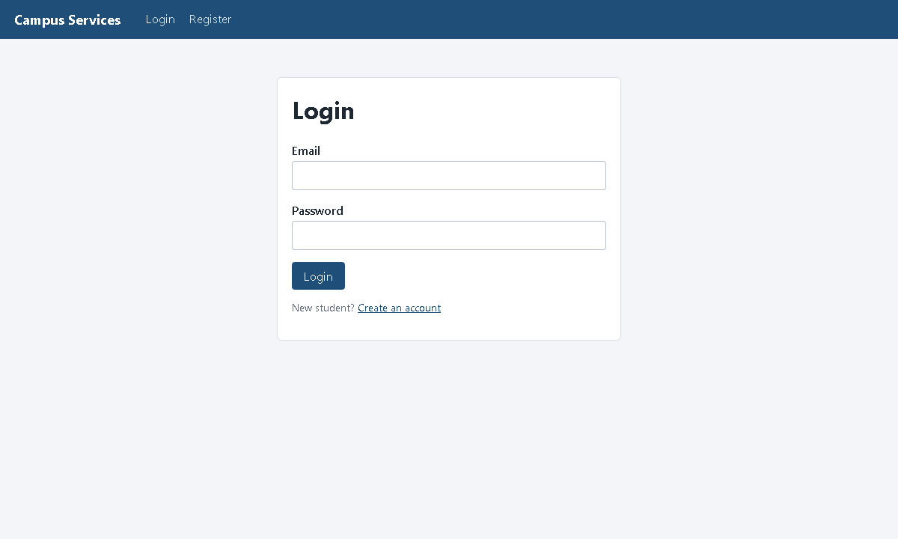
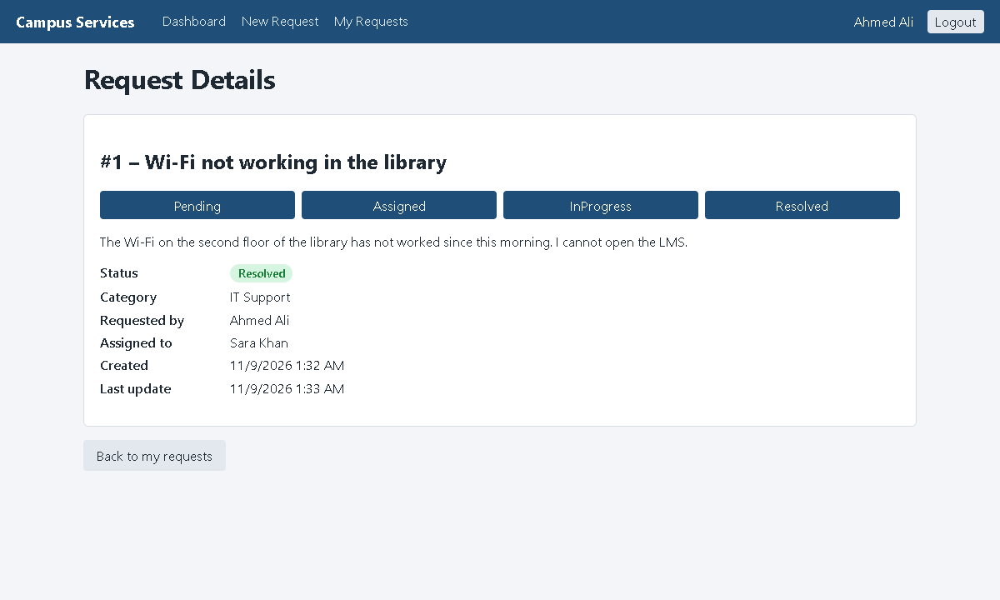
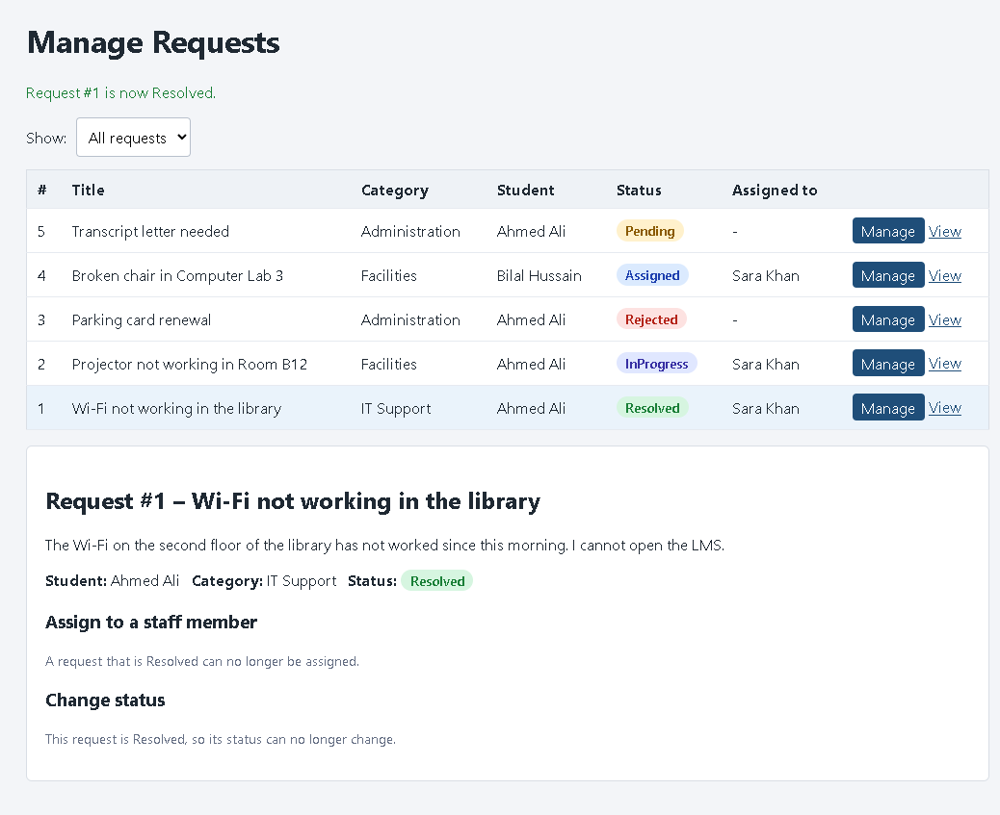

# Campus Services Management System

A university lab project. Students send **service requests** (IT Support, Facilities, Administration) and
staff members assign them and update their status.

* **Student** – registers, logs in, creates requests, tracks their status.
* **Staff** – logs in, sees all requests, assigns them to staff members, updates the status.

The system has two programs that talk to each other over HTTP:

```
 MAUI Blazor Hybrid app  ──── HTTP + JSON (JWT) ────▶  ASP.NET Core Web API  ────▶  PostgreSQL
 (what the user sees)                                  (all rules + security)       (EF Core)
```

> **Lab report (Word):** [docs/Campus-Services-Lab-Report.docx](docs/Campus-Services-Lab-Report.docx) – the full submission
> document in simple English: requirements checklist, design, database, security, screenshots, code, tests,
> how to run, how to demonstrate, and viva questions.
>
> **Architecture notes:** [docs/ARCHITECTURE.md](docs/ARCHITECTURE.md) – layers, SOLID, EF Core, JWT, refresh tokens, N+1.
> Diagrams are in [docs/diagrams](docs/diagrams) and all screenshots in [docs/screenshots](docs/screenshots).

| Login | Student: request details | Staff: manage requests |
|---|---|---|
|  |  |  |

*(Screenshots were taken from the real Windows app talking to the real API, using a temporary test database with demo data.)*

Get the code:

```bash
git clone https://github.com/Usman2k25/assignment.git
```

---

## 1. Technologies

| Area | Technology |
|---|---|
| Language / platform | C# 14, .NET 10 |
| Client | .NET MAUI Blazor Hybrid (Windows + Android) |
| Server | ASP.NET Core Web API, Swagger / OpenAPI (Swashbuckle) |
| Architecture | Clean Architecture (Domain, Application, Infrastructure, API, MAUI) |
| Database | PostgreSQL, Entity Framework Core 10 (Code-First + migrations), Npgsql provider |
| Security | ASP.NET Core Identity, JWT access tokens, refresh tokens, role-based authorization |
| Client → API | typed `HttpClient`, `SecureStorage` for tokens |
| Tests | xUnit, `WebApplicationFactory`, EF Core InMemory |

## 2. Solution structure

Open **`CampusServicesManagementSystem.sln`** in Visual Studio.

```
CampusServicesManagementSystem.sln
├── CampusServices.Domain          Entities, enums, business rules          (depends on nothing of ours)
│   ├── Entities/                  ApplicationUser, ServiceRequest, Category, RefreshToken
│   ├── Enums/                     RequestStatus, StatusRules (allowed status changes)
│   └── Exceptions/                DomainException
├── CampusServices.Application     What the system does                     (depends on Domain)
│   ├── DTOs/                      data sent to / from the API (+ validation attributes)
│   ├── Interfaces/                IServiceRequestService, IAuthService, repository interfaces
│   ├── Services/                  ServiceRequestService (the use cases)
│   └── Exceptions/                NotFoundException, ForbiddenException
├── CampusServices.Infrastructure  Database + Identity + JWT                (implements Application interfaces)
│   ├── Data/                      AppDbContext + Configurations/ (Fluent API)
│   ├── Migrations/                EF Core migrations
│   ├── Repositories/              EF Core queries (AsNoTracking, Include)
│   ├── Auth/                      AuthService, TokenService, JwtSettings
│   └── Seed/                      creates the roles and the optional staff account
├── CampusServices.API             The web API (composition root)           (depends on Application + Infrastructure)
│   ├── Controllers/               Auth, Requests, Categories, Staff
│   ├── Middleware/                ExceptionHandlingMiddleware
│   └── Extensions/                JWT setup, Swagger setup
├── CampusServices.MAUI            The app the user sees                    (talks to the API over HTTP)
│   ├── Services/                  ApiClient (typed HttpClient), AuthService, SessionStore, AppAuthStateProvider
│   └── Components/                Pages/, Layout/, Shared/ (Razor)
└── CampusServices.Tests           46 automated tests
```

Dependency rule: **Domain ← Application ← Infrastructure ← API**. The inner layers never reference the outer ones.
The MAUI app never touches the database – it only calls the API.

## 3. Prerequisites

* **Windows 10/11** with **Visual Studio 2026** (version 18). It was built and compiled with the .NET SDK
  `10.0.401`. (.NET 10 is officially supported by Visual Studio 2026; Visual Studio 2022 is not tested.)
* Visual Studio **workloads** (Visual Studio Installer → Modify):
  * **ASP.NET and web development**
  * **.NET Multi-platform App UI development** (this installs the MAUI, Android and Windows pieces)
* A **PostgreSQL** database – either
  * local PostgreSQL (https://www.postgresql.org/download/), or
  * your existing **Supabase** project (it is PostgreSQL).
* *Optional:* an Android emulator (Visual Studio → Tools → Android → Android Device Manager).

Check what is installed:

```bash
dotnet --list-sdks
dotnet workload list
```

You should see an SDK starting with `10.` and the workloads `android` and `maui-windows`.
iOS / Mac Catalyst were removed from the MAUI project on purpose (they need a Mac).

## 4. Database configuration

The connection string is **not** stored in the project (no passwords in Git). You give it to the API with *user secrets*
(next section). The format is:

```
Host=localhost;Port=5432;Database=CampusServices;Username=postgres;Password=YOUR_PASSWORD
```

**Supabase users:** open *Project Settings → Database → Connection string* and use the **Session pooler** (or the
direct connection) on **port 5432**. Do **not** use the *Transaction pooler* (port 6543) for migrations – it does
not support everything EF Core migrations need. Add `SSL Mode=Require;Trust Server Certificate=true` to the string.

## 5. User secrets (passwords and keys)

User secrets are stored on **your computer**, outside the repository, so they can never be committed.

**In Visual Studio:** right-click **CampusServices.API** → **Manage User Secrets** and paste (change the values!):

```json
{
  "ConnectionStrings": {
    "DefaultConnection": "Host=localhost;Port=5432;Database=CampusServices;Username=postgres;Password=YOUR_DB_PASSWORD"
  },
  "Jwt": {
    "Key": "PUT-A-RANDOM-TEXT-OF-AT-LEAST-32-CHARACTERS-HERE"
  },
  "SeedStaff": {
    "Email": "staff@campus.local",
    "Password": "CHOOSE-A-STRONG-PASSWORD-1!",
    "FullName": "Staff Member"
  }
}
```

**Or with the command line** (run in the solution folder – in Visual Studio: *View → Terminal*):

```bash
dotnet user-secrets set "ConnectionStrings:DefaultConnection" "Host=localhost;Port=5432;Database=CampusServices;Username=postgres;Password=YOUR_DB_PASSWORD" --project CampusServices.API
dotnet user-secrets set "Jwt:Key" "PUT-A-RANDOM-TEXT-OF-AT-LEAST-32-CHARACTERS-HERE" --project CampusServices.API
dotnet user-secrets set "SeedStaff:Email" "staff@campus.local" --project CampusServices.API
dotnet user-secrets set "SeedStaff:Password" "CHOOSE-A-STRONG-PASSWORD-1!" --project CampusServices.API
dotnet user-secrets set "SeedStaff:FullName" "Staff Member" --project CampusServices.API
```

Generate a random JWT key (works in Windows PowerShell):

```powershell
$b = New-Object byte[] 48; [Security.Cryptography.RandomNumberGenerator]::Create().GetBytes($b); [Convert]::ToBase64String($b)
```

What each secret does:

| Secret | Purpose |
|---|---|
| `ConnectionStrings:DefaultConnection` | how the API reaches PostgreSQL |
| `Jwt:Key` | signs the login tokens. At least 32 characters. The API refuses to start without it. |
| `SeedStaff:*` | optional – the API creates this **Staff** account at startup (the password must follow the Identity rules: 6+ characters with an uppercase letter, a lowercase letter, a digit and a symbol) |

Environment variables also work (`ConnectionStrings__DefaultConnection`, `Jwt__Key`, ...), which is how you would do it on a server.

## 6. Create the database (migrations)

The first migration (`InitialCreate`) is already in `CampusServices.Infrastructure/Migrations`. It creates the Identity
tables, `Categories` (with the 3 categories), `ServiceRequests` and `RefreshTokens`. Run these in the solution folder:

```bash
dotnet tool restore
dotnet ef database update --project CampusServices.Infrastructure --startup-project CampusServices.API
```

* `dotnet tool restore` installs the `dotnet-ef` tool that is listed in `dotnet-tools.json`.
* `database update` creates the database if it does not exist and applies all migrations.

Other useful migration commands:

```bash
# after you change an entity: create a new migration, then apply it
dotnet ef migrations add NameOfChange --project CampusServices.Infrastructure --startup-project CampusServices.API --output-dir Migrations
dotnet ef database update --project CampusServices.Infrastructure --startup-project CampusServices.API

# undo the last migration that was NOT applied yet
dotnet ef migrations remove --project CampusServices.Infrastructure --startup-project CampusServices.API

# list migrations / see the SQL that will run (no database needed with --no-connect)
dotnet ef migrations list   --project CampusServices.Infrastructure --startup-project CampusServices.API --no-connect
dotnet ef migrations script --project CampusServices.Infrastructure --startup-project CampusServices.API -o schema.sql
```

> The commands start the API project to read its configuration, so the **user secrets must be set first**.

## 7. Run the API

In Visual Studio: right-click **CampusServices.API** → **Set as Startup Project**, choose the **`http`** profile in the
toolbar, press **F5**. The browser opens Swagger at **http://localhost:5080/swagger**.

Command line alternative:

```bash
dotnet run --project CampusServices.API --launch-profile http
```

On start-up the API creates the roles `Student` and `Staff` (and the staff account from `SeedStaff`, if configured).
If the database is not reachable or not migrated you will see the log message
*"Could not seed the database. Did you run 'dotnet ef database update'?"*.

## 8. Run the MAUI app

1. **Start the API first** (section 7) – the app needs it to log in.
2. Right-click **CampusServices.MAUI** → **Set as Startup Project**.
3. In the toolbar choose the target:
   * **Windows Machine** – easiest. The app calls `http://localhost:5080`.
   * **An Android emulator** – the emulator reaches your PC at `http://10.0.2.2:5080` (already configured
     in `CampusServices.MAUI/Services/ApiSettings.cs`).
4. Press **F5**.

### Run API and app together (multiple startup projects)

Right-click the **Solution** in Solution Explorer → **Configure Startup Projects…** (older versions:
*Properties → Common Properties → Startup Project*) → **Multiple startup projects** → set
**CampusServices.API = Start** and **CampusServices.MAUI = Start** → OK → **F5**.
Choose the MAUI target (Windows Machine / emulator) in the toolbar first. The API has to be running a few seconds before you press *Login*.

Notes:
* A **physical phone** cannot use `localhost`/`10.0.2.2`. Put your PC's IP address in `ApiSettings.cs` and start the API with
  `dotnet run --project CampusServices.API --no-launch-profile --urls http://0.0.0.0:5080` (and allow it through the Windows firewall).
* The Android manifest allows plain `http://` traffic (`usesCleartextTraffic`) only so the emulator can reach the development API. A real deployment must use HTTPS.

## 9. Test accounts

| Role | How to get an account |
|---|---|
| **Student** | Click **Register** in the app (or `POST /api/auth/register` in Swagger). Everybody who registers is a Student. |
| **Staff** | Cannot register themselves (otherwise a student could make themselves staff). The API creates **one** staff account at startup from the `SeedStaff` user secrets (section 5). Log in with that email and password. |

There are no passwords in the repository. Pick your own when you set the user secrets.

## 10. Test the API in Swagger

Open **http://localhost:5080/swagger**.

**A. Successful request**
1. `POST /api/auth/register` → *Try it out* → body `{ "fullName": "Test Student", "email": "student1@example.com", "password": "Student@123" }` → **Execute** → **200**. Copy the `accessToken`.
2. Click the green **Authorize** button, paste the token (only the token, Swagger adds `Bearer`) → **Authorize** → Close.
3. `GET /api/categories` → **200** with the 3 categories.
4. `POST /api/requests` → `{ "title": "Wi-Fi is down", "description": "The Wi-Fi in the library does not work.", "categoryId": 1 }` → **201 Created** (status `Pending`).
5. `GET /api/requests` → **200** (only your requests). `GET /api/requests/1` → **200**.

**B. Validation failure (400)** – `POST /api/requests` with `{ "title": "", "description": "short", "categoryId": 0 }`
→ **400** listing which fields are wrong.

**C. Authorization denial**
* **401 Unauthorized** – click **Authorize → Logout**, then `GET /api/requests` → 401 (no token).
* **403 Forbidden (student → staff-only)** – with the *student* token: `PUT /api/requests/1/status` with `{ "status": "Rejected" }` → 403. Same for `PUT /api/requests/1/assign` and `GET /api/staff`.
* **403 Forbidden (other student's request)** – register a second student, authorize with *their* token, `GET /api/requests/1` → 403.
* **404 Not Found** – `GET /api/requests/99999` → 404.

**D. Staff workflow**
1. `POST /api/auth/login` with the seeded staff email/password → copy the token → **Authorize** (replace the old one).
2. `GET /api/staff` → copy your own `id`.
3. `PUT /api/requests/1/assign` with `{ "staffId": "<that id>" }` → **200**, status becomes `Assigned`.
4. `PUT /api/requests/1/status` with `{ "status": "InProgress" }` → **200**; then `{ "status": "Resolved" }` → **200**.
5. **Invalid transition** – create a new request as a student, then as staff `PUT .../status` with `{ "status": "Resolved" }` while it is still `Pending` → **400** *"A request cannot change from Pending to Resolved."*

**E. Refresh token** – `POST /api/auth/refresh` with `{ "refreshToken": "<from login>" }` → **200** with a *new* pair.
Send the *old* refresh token again → **401** (it is used up). `POST /api/auth/logout` revokes a token.

## 11. Demo script for the app (viva)

1. Start API + app. **Register** a student (see the validation messages when you leave fields empty or use a weak password).
2. Student dashboard → **Create a new request** (try submitting empty first) → you land on the **Request Details** page (status *Pending*).
3. **My Requests** shows the list. Note that the navigation only shows student pages.
4. **Logout**, log in as **staff**. The dashboard shows counts for *all* requests; navigation only shows staff pages.
5. **Manage Requests** → *Manage* on the request → **Assign** to yourself → **Change status** to *InProgress* → *Resolved*.
   The drop-down only offers the allowed next statuses; after *Resolved* nothing more can be changed.
6. Log in as the student again: the request shows *Resolved* with the progress bar completed.
7. Explain: hiding buttons is only convenience. Show in Swagger that a **student token gets 403 on the staff endpoints**.

## 12. Automated tests

```bash
dotnet test CampusServices.Tests
```

46 tests, no database server needed (an in-memory database replaces PostgreSQL; everything else – controllers, JWT,
authorization, middleware – is the real code).

| Required scenario | Tests (class `ServiceRequestApiTests` unless noted) |
|---|---|
| Valid request creation | `Create_WithValidData_Returns201AndPendingRequest` |
| Invalid request validation | `Create_WithInvalidData_Returns400`, `Create_WithUnknownCategory_Returns400` |
| Unauthenticated access | `GetRequests_WithoutToken_Returns401`, `CreateRequest_WithoutToken_Returns401` |
| Student uses a staff-only operation | `Student_CannotAssignRequest_Returns403`, `Student_CannotChangeStatus_Returns403`, `Student_CannotListStaffMembers_Returns403` |
| Student accesses another student's request | `Student_CannotViewAnotherStudentsRequest_Returns403`, `Student_CannotEditAnotherStudentsRequest_Returns403`, `StudentList_ContainsOnlyTheirOwnRequests` |
| Request does not exist | `GetRequest_ThatDoesNotExist_Returns404`, `Staff_ChangingStatusOfMissingRequest_Returns404` |
| Invalid status transition | `Staff_InvalidStatusTransition_Returns400`, plus the rule tests in `ServiceRequestDomainTests` |
| Unexpected server error (500, no details leaked) | `UnexpectedError_Returns500_AndDoesNotLeakDetails` (`ErrorHandlingTests`) |
| Login / refresh / roles (`AuthApiTests`) | register, wrong password, weak password, duplicate email, lockout, cannot register as Staff, refresh rotation, logout revocation |

## 13. Roles at a glance

| Action | Student | Staff |
|---|:-:|:-:|
| Register | ✔ | – (account is seeded) |
| Create a request | ✔ | ✘ |
| See requests | own only | all |
| Open a request's details | own only | any |
| Edit a request (title, text, category) – API only (`PUT /api/requests/{id}`), the app has no edit screen | own, while *Pending* | ✘ |
| Assign a request | ✘ | ✔ |
| Change the status | ✘ | ✔ (valid transitions only) |

Status transitions: `Pending → Assigned | Rejected`, `Assigned → InProgress | Rejected`, `InProgress → Resolved | Rejected`.
`Resolved` and `Rejected` are final. (Defined once in `CampusServices.Domain/Enums/StatusRules.cs`.)

## 14. Troubleshooting

| Problem | Fix |
|---|---|
| `Jwt:Key is missing or shorter than 32 characters` | Set the `Jwt:Key` user secret (section 5). |
| `ConnectionStrings:DefaultConnection is missing` | Set the connection-string user secret. |
| `dotnet ef` says it cannot find the tool | Run `dotnet tool restore` in the solution folder. |
| Log message *Could not seed the database* | The database is unreachable or not migrated – check the connection string, run `database update`. |
| Login in the app says *Cannot reach the server* | The API is not running, or the address in `ApiSettings.cs` is wrong for your target (Windows vs emulator vs phone). |
| Staff cannot log in | `SeedStaff:Email` / `SeedStaff:Password` secrets are missing (or the password breaks the Identity rules), then restart the API. |
| Supabase: migration hangs or fails | Use the **Session pooler / direct** connection on port **5432**, not the 6543 transaction pooler. |
| Visual Studio cannot build MAUI | Install the *.NET Multi-platform App UI development* workload; run `dotnet workload list`. |
| Port 5080 already in use | Stop the other process, or change the port in `launchSettings.json` **and** `ApiSettings.cs`. |

## 15. What was verified, and what was not

Verified (on the machine that created this project):

* The whole solution restores and builds (`dotnet build`), including the MAUI **Windows** and **Android** targets – 0 warnings, 0 errors.
* `dotnet test` – 46 passed. The security tests were also proven to fail when the protection is removed.
* The EF Core migration was generated and the SQL it produces was reviewed (`dotnet ef migrations script`).
* The real API starts with user secrets, serves Swagger with the JWT *Authorize* scheme and answers 401 without a token.
* The real **Windows MAUI app** was run against the real API (with a temporary in-memory database) and the full Student and Staff workflows, validation messages, role-based navigation, login persistence across an app restart (SecureStorage), automatic refresh-token rotation and the "session expired" path were exercised.

**Not verified** (you need to do this):

* Opening and running the solution **inside Visual Studio** (the commands and toolbar steps above are standard but were not executed in the IDE).
* `dotnet ef database update` against a **real PostgreSQL / Supabase** database (none was available).
* Running the app on an **Android emulator or phone** (it compiles, it was not launched).
